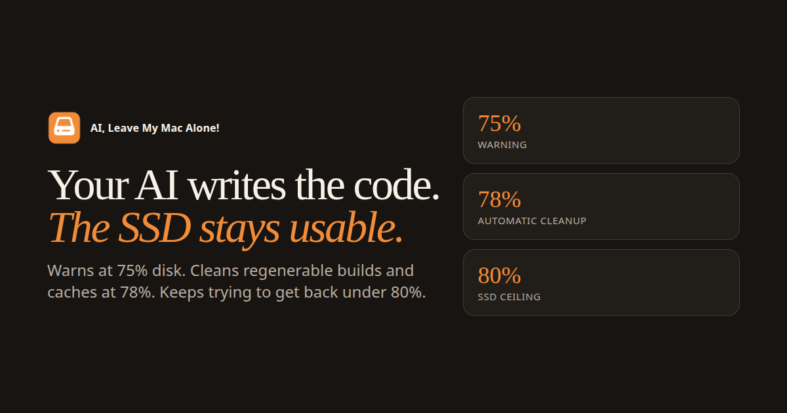
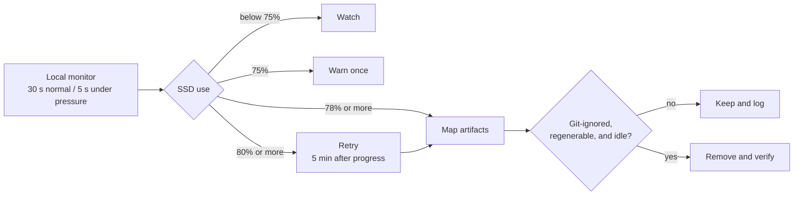

<p align="center">
  
</p>

<h1 align="center">AI, Leave My Mac Alone!</h1>

<p align="center">
  <strong>Autonomous SSD protection for people building with AI.</strong><br>
  Built for the technical residue left by Codex, Claude Code, and coding agents.
</p>

<p align="center">
  <a href="https://luisroquette-labs.github.io/ai-leave-my-mac-alone/"></a>
  <a href="https://github.com/luisroquette-labs/ai-leave-my-mac-alone/releases/tag/v2.3.1"></a>
  <a href="https://github.com/luisroquette-labs/ai-leave-my-mac-alone/actions/workflows/ci.yml"></a>
</p>

<p align="center">
  <a href="https://luisroquette-labs.github.io/ai-leave-my-mac-alone/"></a>
</p>

## Your AI finishes the task. The gigabytes stay.

Agents work in parallel, create worktrees, install dependencies, and repeat builds. After the delivery, `node_modules`, `.next`, and tool caches still occupy the SSD. The failure shows up late: the next build breaks, an update stops, or macOS runs out of working space.

AI, Leave My Mac Alone! samples the data volume every 30 seconds and speeds up to 5 seconds under pressure, without interrupting the session.

## What the percentages actually do

The menu shows `usedPercent`, which is the raw fraction rounded to the nearest integer. Warning, cleanup, the monitoring interval, and the hard-limit cooldown all use that same rounded number.

| Rounded disk use | What v2.3.1 does |
|:---:|---|
| **Below 75%** | Watch. Sample every 30 seconds. A warning latch resets once use falls below 73%. |
| **75–77%** | One warning. Sample every 5 seconds. No cleanup yet. |
| **78–79%** | Automatic cleanup, if it is on, at the level you authorized. After a round that frees at least 100 MB, wait 60 seconds. |
| **80% and above** | The ceiling. The same cleanup continues. After a round that frees at least 100 MB, wait 5 minutes. Native tool caches are added only when use is still at or above 80% after the safe artifacts. The menu reports the bytes still required. |

A round that frees under 100 MB backs off for 5, then 10, then 20, then 30 minutes. That backoff applies from 78% upward, including above 80%.

Memory is a separate gauge:

| Swap | What the app does |
|:---:|---|
| **Below 75%** | Normal. |
| **75% and above** | Warning on the memory gauge. |
| **90% and above, and free RAM under 300 MB** | Automatic memory relief, if it is on, then a 60 second cooldown. |

`StoragePolicy.emergencyThreshold` is `0.95` and a test pins that constant. No production path reads it. Crossing 95% disk does not change the level, the cooldown, or which files can be removed. **Emergency is a cleanup level you authorize, not a disk percentage.** The previous demo video said the disk warns at 90% and cleans at 95%. That description does not match the code; the GitHub About text was corrected on 2026-11-21.



If the menu shows **80%**, the ceiling retry is already active.

## A category for AI workflows

CCleaner and generic utilities do broad system maintenance. AI, Leave My Mac Alone! understands software projects: Git, worktrees, running processes, builds, and regenerable caches. The point is not to “clean the Mac”. It is to stop coding agents from quietly filling the SSD.

- **Autonomous:** starts with the session and checks the disk every 5 seconds from 75% up.
- **Three levels:** Safe, Deep, and Emergency can run now, or be authorized for automation.
- **Local:** no data, path, or event leaves the computer.
- **Auditable:** the code, the rules, and the log of each run are public or local.

## Safety contract

| May remove | Never removes |
|---|---|
| npm, Bun, Deno, and Homebrew caches | Documents, Desktop, Downloads, and personal media |
| Xcode builds and recognizable npm/Deno caches older than 24 h in `/private/tmp` | Browser profiles, current Claude/Codex sessions, and unknown temporary files |
| `node_modules`, `.next`, `.build`, `.turbo`, `.venv`, `DerivedData`, and `dist` of 100 MB or more | Dirty, active, recent, branchless, or unknown-ignore worktrees |
| Git-ignored artifacts inside a Git repository | Projects used by any user process |
| Only after Git and processes are checked again | Trash, Docker, credentials, and external disks you did not select |
| At an authorized Emergency level: Codex files archived for 7 days, and Claude VM bundles with no open files | Recent Codex history and any target in use or not verifiable |

Process inspection fails closed: if macOS cannot confirm that a project is idle, the target stays. Git is compared before and after removal. Failures and recreations are part of the run result.

> The 80% ceiling is **best-effort**. It is not treated as done while the disk stays above it. The app respects the highest automatic level you authorized, widens the attempt only inside that permission, and reports how many bytes are still required. Retries back off from 5 to 30 minutes. Personal data and active projects stay protected.

## Cleanup levels and permission

| Level | Manual | Authorized automation | Extra scope |
|---|---|---|---|
| **Safe** | Its own button | Default | Checked regenerable caches and builds |
| **Deep** | Its own button | Persistent choice | Inactive worktrees and recognizable temporary files |
| **Emergency** | Explicit confirmation | A separate persistent authorization | Codex files archived for 7 days, and Claude VM bundles with no open files |

The automatic level is a ceiling: choosing Safe blocks a silent jump to Deep or Emergency. Every disposal still uses one exact, auditable batch.

## Chrome memory relief

In **Settings → Chrome**, click **Show extension folder…**. On `chrome://extensions`, turn on **Developer mode** and choose **Load unpacked** for the `ChromeExtension` folder Finder reveals. Installation is once per Chrome profile. The extension’s default language is English; Chrome shows Portuguese when that is the browser language.

With less than 2 GB of RAM free, the extension asks Chrome to discard up to 8 low-priority tabs every 30 seconds. Chrome stays open and the tabs stay listed, but they reload when selected; unsaved content in them can be lost. The extension does not read page content and does not send data over the network. Orphan-build relief inside the app stays independent.

## Where cleaned files go

Open **More options → Settings** and choose:

| Destination | Behavior |
|---|---|
| **Move to the Trash** | Keeps the batch recoverable. Space returns when you empty the Trash. |
| **Trash, then delete only this app's batch** | Deletes only the new batch from AI, Leave My Mac Alone!. Older Trash items stay. |
| **Back up to an external drive, then delete from the Mac** | Copies and validates every artifact, moves the original into an exclusive batch, and deletes only that batch. |

The external backup accepts only a writable folder on a volume that is not internal. If the disk is disconnected, full, the copy differs, or the delete fails, the original stays recoverable and the run fails closed.

## How much space it has freed

Each finished run appends a line like `END liberados=<bytes>` to the local log. `liberados` is the increase in free bytes on the data volume during that run, not a sum of file sizes. Trash-only runs often record `0` because the space comes back when the Trash is emptied. If other writes filled the disk during the run, that run also records `0`.

From a checkout:

```bash
./Scripts/report-freed.sh
```

On the Mac that already runs the app, paste this in Terminal. It does not need a checkout:

```bash
log_dir="${HOME}/Library/Logs/CleanMyMac"
files=()
[[ -f "$log_dir/clean-my-mac.log" ]] && files+=("$log_dir/clean-my-mac.log")
[[ -f "$log_dir/clean-my-mac.previous.log" ]] && files+=("$log_dir/clean-my-mac.previous.log")
if (( ${#files[@]} == 0 )); then
  printf 'No cleanup log yet at %s/clean-my-mac.log\n' "$log_dir"
else
  awk '
    /END liberados=/ {
      if (match($0, /liberados=[0-9]+/)) {
        bytes = substr($0, RSTART + 10, RLENGTH - 10) + 0
        total += bytes
        runs++
        if (bytes > 0) positive++
      }
    }
    END {
      printf "Completed runs: %d\n", runs + 0
      printf "Runs that increased free space: %d\n", positive + 0
      printf "Free space gained: %.2f GB\n", (total + 0) / 1000000000
      printf "Free space gained: %.2f GiB\n", (total + 0) / 1073741824
    }
  ' "${files[@]}"
fi
```

The directory in that command is a stable internal path. Renaming it would split the history. Only the current log and one rotated previous log are kept (rotation at 5 MB), so the total is not a lifetime counter beyond those two files.

## What changed in v2.3.1

- The critical alert no longer appears when the rounded percent shows 80% but the exact byte math says the SSD is already under the ceiling.

## What changed in v2.3.0

- Three separate buttons run Safe, Deep, or Emergency cleanup.
- You choose the highest level automation may use. Emergency requires its own persistent authorization.
- Emergency keeps seven days of Codex files, removes only regenerable Claude bundles with no open files, and still blocks current sessions, projects, and personal data.

## What changed in v2.2.1

- A full worktree scan that finds nothing is not repeated for an hour. Later rounds go straight at regenerable artifacts and caches.
- The app counts progress only when free space actually grows by at least 100 MB, even if concurrent writers recreate what was just removed.
- When cleanup cannot protect the 80% ceiling, the menu and a native alert state the shortfall. The alert still works when macOS refuses notifications for an ad-hoc signature.

## What changed in v2.2.0

- The optional Chrome extension frees memory from inactive tabs when less than 2 GB of RAM remains. The browser and the tabs stay open; discarded tabs reload when you return.
- Extension installation is available in the app’s Settings and requires one activation per Chrome profile.

## What changed in v2.1.5

- Cache cooldown is per path: a cache that was just rebuilt stays protected for 6 hours, while other safe caches remain available to restore the 80% ceiling. Last-resort resources enter one per round, with a fresh measurement between them.
- Active projects under `~/.cache/codex` are blocked, symlink-traversed paths are rejected, and a failure while finishing a batch stops the later destructive layers.
- The second redundant worktree scan was removed. Each round does one selection guarded by Git state and running processes.
- Preventive cleanup at 78% runs again, stops when it recovers the calculated shortfall, and uses native caches only while still above 80%. Interrupted batches resume with strict validation.
- Memory relief no longer kills a young build only because it passed 1 GB. Aside from disposable telemetry, only real orphans (`PPID 1`) that are also old are eligible.

## What changed in v2.1.4

- Cleanup advances through an exact allowlist of regenerable development and browser caches when safe artifacts are not enough, with a 2 GB margin against the gap between estimated size and space actually recovered.
- Profiles, sessions, credentials, `.env`, Graphify, and `Warning/Default` stay out of reach.

## What changed in v2.1.3

- Clean worktrees whose only extra metadata comes from TypeScript, Next.js, SWC, and tests are no longer preserved by mistake, so the 80% ceiling can be pursued without deleting `.env`, `.vercel`, Graphify, agent output, or active work.

## What changed in v2.1.2

- At 80% or above, a whole worktree can be recovered only when its branch is preserved in Git, it is clean, idle for 24 hours, has no running process, and contains only known regenerable ignores.
- The search also covers `*-worktrees` containers and `.worktrees` inside projects, which is where tens of gigabytes accumulated beyond `node_modules` / `.next`.
- Ignored Swift/Xcode builds, Turbo, virtual environments, and `dist` join the safe policy. npm/npx, uv, and pnpm use their own official prune commands.
- `.env`, local Graphify, `Warning/Default` paths, dirty/active/recent worktrees, and Claude/Codex sessions stay blocked.

## What changed in v2.1.1

- Emergency cleanup tries to get under 80% in a single round, walking every available safe artifact, and says clearly when the target cannot be reached without touching protected data.
- The cleanup result stays visible after metrics refresh. The interface no longer replaces “how much was freed” with a plain disk reading.
- Worktree verification no longer updates the Git index during inspection, so the app itself does not make an idle worktree look active.
- Deep-cleanup confirmation is explicit and separate from normal cleanup.

## What changed in v2.1.0

- Idle Git worktrees are cleaned again: no commit, checkout, stage, or file change inside the worktree for 4 hours (1 hour if the branch was already deleted on the remote). An agent terminal can stay open for days. What matters is activity inside the worktree. Before this, every worktree was skipped and 55 GB of finished-work `node_modules` pushed the SSD to 97.6% (2026-10-02).
- The scan covers `~/.worktrees` and `~/.codex/worktrees`. The rest of `~/.codex` stays protected.
- An artifact another worktree uses through a symlink is never removed.
- A round with no progress doubles the next wait (5 → 10 → 20 → 30 min), even above 80%. That ended the repeated scans every 15 seconds that freed nothing.

## What changed in v2.0.1

- Memory relief now sees orphans that were paged out to swap: a build/dev target with 2h+ of uptime is quit even with low RSS. The old 1 GB filter went blind exactly under swap pressure — a real incident on 2026-09-14 with swap at 96% and 1,278 triggers that did nothing.
- Next.js telemetry orphans (`detached-flush.js`) are always quit.
- An idle Docker VM (colima) is stopped with a graceful `colima stop`, and only when `docker ps` is provably empty. A running container keeps the VM up.
- The extra-target decision lives in pure Core policy, covered by regression tests from that incident.

## What changed in v2.0.0

- Public name set to AI, Leave My Mac Alone!. The bundle identifier, the log directory, and the internal modules stayed the same so macOS permissions already granted are kept.
- New automatic and manual memory relief: quits orphan Next.js/tsc/webpack/vite/turbo/vitest builds that exhaust RAM or swap, with the same safety boundary as disk cleanup.
- Redesigned panel: a gauge marked at the real policy thresholds (75/78/80% disk, 75/90% swap), monospaced numbers, and ruled sections.

## What changed in v1.2.5

- Above 80%, cleanup tried again every 15 seconds even when the previous round freed nothing. Later versions replaced that fixed retry with the backoff described above.
- If artifacts are not enough, the same round moves on to native caches. Bun uses a controlled directory, and failures enter the result.
- Inactive `.next` and `node_modules` in project worktrees inside `.claude` join the safe list. `~/.claude` itself stays protected.

## Install

1. Open the [official download page](https://luisroquette-labs.github.io/ai-leave-my-mac-alone/#download).
2. Enter your name, WhatsApp, and email to unlock the free ZIP.
3. Move **AI, Leave My Mac Alone!.app** to `Applications`.
4. On the first launch of an ad-hoc build, run:

```bash
xattr -dr com.apple.quarantine "/Applications/AI, Leave My Mac Alone!.app"
open "/Applications/AI, Leave My Mac Alone!.app"
```

The current build requires **macOS 14+**, an **Apple silicon** Mac, and uses an ad-hoc signature. It is not notarized yet. The exact Developer ID, `notarytool`, and `stapler` commands are in [`docs/SIGNING.md`](docs/SIGNING.md). After a stapled notarized build, the `xattr` command is unnecessary.

The menu follows the Mac language. English is the default. Portuguese is used when it appears ahead of English in the language list. The website has the same choice: English first, PT on the language control or `?lang=pt`.

## Use

1. Find the disk icon in the macOS menu bar, near Wi-Fi and the clock.
2. Keep **Automatic cleanup** on.
3. Keep **Open at login** on.
4. Use **Check now** or **Clean now** for an immediate run.

The log path is printed by `./Scripts/report-freed.sh`.

## Small native architecture

| Component | Responsibility |
|---|---|
| `StorageMonitor` | Sampling, notifications, login, and orchestration |
| `StoragePolicy` | Thresholds, the normal cooldown, and the ceiling retry |
| `SafeCleaner` | Candidates, processes, Git, removal, and the audit log |
| `MenuBarView` | SwiftUI interface in the macOS menu bar |

Swift 6, SwiftUI, AppKit, ServiceManagement, and UserNotifications. No runtime dependency, Electron, account, or cloud service.

Module boundaries and the security model: [`docs/ARCHITECTURE.md`](docs/ARCHITECTURE.md).

## Build and verify

```bash
git clone https://github.com/luisroquette-labs/ai-leave-my-mac-alone.git
cd ai-leave-my-mac-alone
./Scripts/preflight.sh
open "dist/AI, Leave My Mac Alone!.app"
```

The canonical preflight checks `Info.plist`, the web model tests, desktop and mobile end-to-end tests, the Swift tests, the release build, the public version, and the app signature. It needs a Mac.

## Project scope

Artifact search covers `~/Projects`, `~/Projetos`, `~/Developer`, `~/Code`, agent worktrees in `~/.worktrees` and `~/.codex/worktrees` (the rest of `~/.codex` stays protected), and home folders that directly contain `.git` or `package.json`. Personal macOS areas and protected paths are excluded before the scan. Project worktrees inside `.claude` are walked only to find large Git-ignored `.next` and `node_modules` with no running process.

A Git worktree’s artifacts are eligible only when it is idle: no commit, checkout, stage, or modified file (outside `node_modules` / `.next` / `.git`) in the last 4 hours, or in the last hour if the branch upstream was already deleted. An agent terminal can stay open for days. Activity inside the worktree is what counts. An artifact another worktree uses through a symlink is never removed. A round with no progress doubles the next wait (5 → 10 → 20 → 30 min), even above 80%.

Above 80%, a whole worktree can enter the exact batch only after 24 hours without activity, with its branch preserved, a clean Git status, no running process, and only recognized regenerable ignores. Any `.env`, Graphify output, or unknown ignore keeps the whole worktree.

## Privacy

Storage samples, preferences, and logs stay on the Mac. The app has no network client, analytics, telemetry, account, or remote backend. The download form on the website posts the contact you type to CF Gauss. The installed app does not.

## Known limitations

- The 80% ceiling depends on safe artifacts existing. While the disk is above it, the app keeps trying and stays as close as it can without deleting active work.
- Trash mode does not return space to the SSD until you empty the Trash.
- Projects outside the documented roots are not scanned.
- Caches are cleaned only when that tool is installed.
- The distributed build is Apple silicon only and is not notarized yet.
- The published 2.3.1 ZIP predates the English menu. The next release notes are drafted in [`docs/RELEASE_NOTES_NEXT.md`](docs/RELEASE_NOTES_NEXT.md) and are not published.

## Open source

[MIT](LICENSE) © 2026 [Luis Roquette](https://github.com/luisroquette).

AI, Leave My Mac Alone! is independent software. It is not affiliated with, sponsored by, or endorsed by MacPaw.
